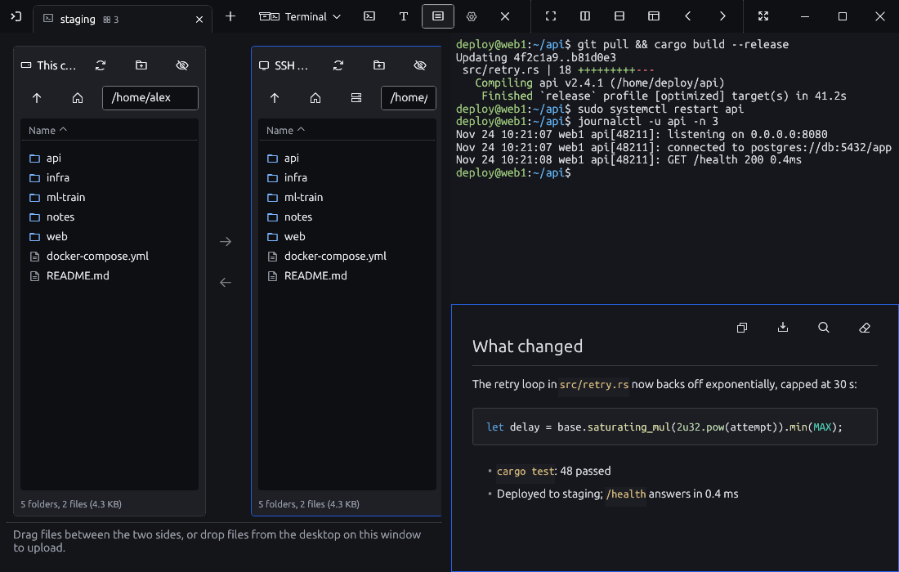

# SSH Remote

**One workspace for all your servers and projects.** Split terminals across hosts, read an AI
agent's answer as Markdown, open a host's files or desktop in the next pane, all over the SSH login
you already have. No account, no open port, nobody in between.



[Website](https://sshremote.dev) · [Download](https://sshremote.dev/#download) ·
[Docs](https://sshremote.dev/docs.html) · [In the browser](https://web.sshremote.dev) ·
[Extensions](https://sshremote.dev/extensions.html)

## Why

Developers who look after many machines end up with a pile of terminal windows, a separate remote
desktop app, an SFTP client and a browser tab per dashboard, and lately an AI agent scrolling away
in one of those terminals. SSH Remote puts all of it in one window: each tab is a computer, split
into panes, and each pane is that computer's terminal, its screen or its files, switched in place.
It needs nothing on the server but the same single file, started over the SSH you already use.

## Features

- **Workspace.** Tabs and splits across hosts, layouts for many panes, tabs torn off into windows
  of their own, a set of tabs kept as a project and opened again whole, connections that come back
  by themselves.
- **Terminals.** A full terminal emulator with scrollback search, links, pictures (sixel and the
  kitty protocol) and profiles for local shells, SSH hosts and `~/.ssh/config` aliases.
- **Coding with AI agents.** Any output read as rendered Markdown, with an agent's prompts, replies
  and code blocks laid out as a document. Files and screenshots dropped or pasted into a terminal
  land on that host. `sshremote mcp HOST` gives any agent the host's screen, its window as text,
  clicks and keys through the Model Context Protocol.
- **Screens and files.** The host's desktop with keyboard, mouse, monitors, one window or one
  program, clipboard with files and pictures, sound, chat and voice calls; two-sided file transfer
  with drag and drop. Lossless text in about half of RustDesk's AV1 traffic.
- **Remote access by ID.** For a PC behind Wi-Fi or NAT with no SSH: a 9-digit ID and a password,
  sealed end to end (SPAKE2, ChaCha20-Poly1305) through a relay that only copies bytes, straight
  past it when hole punching finds a path. Also from a browser at
  [web.sshremote.dev](https://web.sshremote.dev).
- **The SSH chores.** Keys made, copied and installed, passwords in the system's password store,
  tunnels (local, remote, SOCKS), and a passphrase-protected backup of your computers and `~/.ssh`.
- **Extensions.** Panels, commands, styles, scripts and programs from a signed registry, each held
  to the permissions it names.

Hosts: Windows, macOS, and Linux with GNOME, KDE Plasma, Sway, Hyprland, COSMIC or any X11 desktop.
Viewers: the native window (Windows, macOS, Linux), a terminal that shows pictures, or a browser.

## Install

One line puts it in place, on your computer and on each host you want to reach:

```sh
curl -fsSL https://sshremote.dev/install.sh | sh      # macOS and Linux
```

```powershell
irm https://sshremote.dev/install.ps1 | iex           # Windows, in PowerShell
```

```sh
brew install --cask sshremote-dev/tap/sshremote       # macOS with Homebrew (the app, and sshremote)
brew install sshremote-dev/tap/sshremote              # Linux with Homebrew
```

Each takes the current version from [GitHub Releases](https://github.com/sshremote-dev/sshremote/releases),
checks its SHA-256 against the list on sshremote.dev and puts it in place: `~/.local/bin/sshremote`
on Linux, the app in Applications on a Mac, and on Windows `%LOCALAPPDATA%\Programs\SSH Remote`
with a Start menu entry and the folder on `PATH`. Or download a file from
[GitHub Releases](https://github.com/sshremote-dev/sshremote/releases/latest), or build it:

```sh
cargo build --release
```

There are builds for Windows and Linux on x86_64 and Arm, and one Mac app for Apple silicon and
Intel. The Windows and Linux files are built by [GitHub Actions](.github/workflows/release.yml)
from the tagged source and run on their own system before they ship, each with a build attestation
(`gh attestation verify FILE -R sshremote-dev/sshremote`); the Mac app is built and signed on the
project's Mac. How a release is made, and how a platform is added: [docs/releasing.md](docs/releasing.md). The Windows file
is not code-signed and the Mac app not notarized, so a copy downloaded with a browser is checked
the first time it runs (SmartScreen's **More info**, then **Run anyway**; on a Mac, right click
and **Open**); the install lines above download without that mark.

## Quick start

```sh
sshremote                                  # the window: your computers, ~/.ssh/config included
sshremote --gui user@host --open files     # straight to a host's terminal, screen or files
sshremote user@host                        # the host's screen in this terminal (sixel or kitty)
sshremote remote-access on                 # reachable by ID, for a PC without SSH
sshremote mcp user@host                    # an MCP server for AI agents
```

## How it works

There is one program. On the viewer it is the window (or the terminal viewer, the browser gateway,
the MCP server); on the host it is the agent, started over SSH as `ssh -T HOST sshremote --agent`.
The agent sends an exact copy of the screen as changed rectangles and moves in one zstd stream
(AV1, or H.264 for older viewers, only for areas that keep moving), along with terminals, files,
clipboard and sound. Over SSH
there is no relay, ID server or open port. Remote access by ID runs the same protocol through
[sshremote-relay](https://github.com/sshremote-dev/sshremote-relay), sealed end to end, for
computers SSH cannot reach.

## Compared with

- **ssh and tmux** give you terminals; SSH Remote adds the host's screen and files in the next
  pane, keeps every host's terminals in one window, and reads an agent's output as a document.
- **Remote desktop tools** such as RustDesk or TeamViewer need their service and, by default, their
  servers in between; over SSH nothing sits between you and the host, and when you do need a relay
  (remote access by ID) it only copies bytes sealed end to end.
- **Editor remotes** such as VS Code Remote-SSH install a server and open one host per editor
  window; SSH Remote is not tied to an editor and needs only itself on the host.

## Repositories

| Repository | What it is |
|---|---|
| [sshremote](https://github.com/sshremote-dev/sshremote) | The app: window, agent, terminal viewer, web gateway, MCP server, site and release scripts |
| [sshremote-relay](https://github.com/sshremote-dev/sshremote-relay) | The relay for remote access by ID |
| [sshremote-extensions](https://github.com/sshremote-dev/sshremote-extensions) | The registry's extensions (`scripts/deploy.sh` expects it beside this one) |

## Contributing, security and license

Issues and pull requests are welcome; see [CONTRIBUTING.md](https://github.com/sshremote-dev/.github/blob/main/CONTRIBUTING.md).
Report security problems privately, as [SECURITY.md](https://github.com/sshremote-dev/.github/blob/main/SECURITY.md)
describes. SSH Remote is under the [MIT license](LICENSE). The licenses of the open-source software
built into it are in [THIRD-PARTY-NOTICES.txt](THIRD-PARTY-NOTICES.txt), which `sshremote licenses`
prints and Settings opens (Open-source licenses); `scripts/licenses.py` makes it from Cargo.lock,
and CI checks it is current.

## Feature reference

Remote control over the SSH login you already have: a terminal, the host's screen with keyboard and
mouse, files, and an MCP server for AI agents. Over SSH there is no relay, ID server or open port:
the viewer runs `ssh -T HOST sshremote --agent` and keeps an exact copy of the screen from changed rectangles and
moves sent in one zstd stream (AV1, or H.264 for older viewers, only for areas that keep moving).

Hosts: Windows (GDI capture, SendInput); GNOME on Wayland (Mutter RemoteDesktop, PipeWire); X11
desktops such as Xfce, MATE, LXQt, Cinnamon, i3, and KDE or GNOME on Xorg (MIT-SHM, XDamage, XFixes,
XTest, with no dialog); Hyprland, Sway and other wlroots-based desktops (wlr-screencopy, a virtual
pointer and keyboard, with no dialog); and other Wayland desktops through the xdg desktop portal (KDE
Plasma, COSMIC: allowed once at the screen, then kept where the desktop keeps it).
A desktop whose screen cannot be shared still gives its terminal and files.

**Cameras** (as RustDesk's view camera): the host's cameras are listed after its monitors, in the
window's monitor menu, the web page's and the terminal viewer's (Ctrl+] n), and shown when picked,
to look at only (Linux through GStreamer, Windows through Media Foundation). A viewer by ID sees
them only when the computer's settings allow it (`remote-access cameras on`, off by default), and
the person at the screen is told each time one is looked at.

Viewers: a native window, or a terminal that shows pictures: sixel (Windows Terminal, foot, VTE)
or, in true colour, the kitty graphics protocol (kitty, Ghostty, WezTerm), found by asking the
terminal (`SSHREMOTE_GRAPHICS=sixel` or `kitty` decides instead). Inside tmux in kitty, kitty images
are placed by Unicode placeholders, so the picture moves and hides with tmux's windows and panes.

**Programs in a pane** (as Remote Desktop's RemoteApp, with the **Programs** extension), opened
three ways: **Search** finds the computer's installed programs by name as the Start menu's search does
(the start of the name or of a word in it, its initials, its program file; its desktop entries on
Linux, the Start menu on Windows, Store apps too), **Command** runs a command line as Run does (a
folder, a file or an address opens with its program), and **File** opens a file or a folder picked
from the computer's folders. What it starts opens in a pane, showing that program alone (with its
menus and dialogs) and taking clicks and keys for it. Home's Tools and Quick open (also when
splitting a pane) open this computer's programs, the program's own window held in the pane (moved
and sized with it, out of the way of the app's menus, hidden with its tab and closed with the pane;
it is unseen as it opens and shown once it is in place, so it never shows outside first): on
Windows, in X11 sessions, and under Wayland, which lets no program place another's windows, on GNOME
through the sshremote helper extension (GNOME loads a new version at the next login), on KDE
Plasma through KWin scripts, and on Sway and Hyprland through their IPC (the program opens on a
workspace out of sight, then floats over its pane without a border). On other Wayland desktops
(COSMIC) and tiling window managers the pane shows it as it would another computer's, or leaves it a
window of its own. Programs are opened there only, in the new-open view (Home and Quick open): a
screen's toolbar and the web page offer none. Without the extension the Tools are not there.

## Build

```sh
cargo build --release
```

On Debian or Ubuntu, Linux needs a C++ compiler and `pkg-config cmake nasm libgstreamer1.0-dev
libgstreamer-plugins-base1.0-dev libasound2-dev libxkbcommon-dev libwayland-dev`; the
tests also want `openssh-client fonts-dejavu-core`. [CI](.github/workflows/ci.yml) builds it this
way on every push. Put the binary on the host as `~/.local/bin/sshremote` (Windows: anywhere on
`PATH`).

## Tests

`cargo test` runs the tests that need nothing else. The ignored ones start the built program, draw
windows, save passwords or reach other computers. Run them one at a time:
`SSHREMOTE_EXE=$PWD/target/debug/sshremote cargo test -- --ignored --test-threads=1`.

On a Linux computer with GNOME, `scripts/gnome-session.sh up` starts a private headless GNOME
session: its own bus, PipeWire, password store and virtual monitor. Tests run in it with
`scripts/gnome-session.sh run ...` leave the desktop of whoever is signed in alone. `shot FILE`
takes a picture of it through `sshremote mcp`, and `down` stops it.
`SSHREMOTE_SNAP_DIR` keeps the windows' pictures; `secret-tool` must be on `PATH` for the password
tests.

Tests that reach other computers name them by ssh alias:
- `SSHREMOTE_WINDOWS_HOST`: a Windows computer with the service installed.
- `SSHREMOTE_SSH_HOST`: any host with sshremote.
- `SSHREMOTE_GNOME_HOST`: a GNOME host. Add `SSHREMOTE_GNOME_ENV="$(scripts/gnome-session.sh env)"`
  (run there) for its private session.

## The window

`sshremote` opens its home window in two columns:

- **This computer** on the left: how others reach it (its remote access ID, IP addresses, full
  name, and `user@IP` when an SSH server answers), each copied with a click; then remote access by
  ID: its switch, password, state and who is connected, with its settings in a sheet.
- **Going out** on the right: one address field for `user@host`, an alias, an IP or an ID. It says
  what it reads there and opens a terminal, the screen or the files on it; an ID asks for its
  password in place. Under it the computers: this computer first, then favorites and the last
  opened, with the aliases of `~/.ssh/config`. A computer's sheet (Add, or Edit in its menu) keeps
  its name, its address or its `~/.ssh/config` block (host, user, port, key), its saved password,
  its network card for **Wake-on-LAN** and its **tunnels** (`-L`, `-R` or SOCKS through an SSH
  computer; a port here to anything a computer by ID reaches), opened on demand or with the app.
  **On this network** lists the computers nearby with remote access on, to add without typing
  their ID. Computers can carry **tags** (work, servers), and the chips over the list show one
  tag's.
- **Web apps** (with the **Web apps** extension): an `https://` address opens as a pane (**Open in
  a pane**, or + to keep it in the list), and its tools are listed under **Tools** (Google
  Translate, Papago, DeepL, Claude, ChatGPT, Gemini, Gmail, Calendar, Keep, Notion); without it a
  typed address says where to get it. Each is a page
  of Chrome, Edge or Chromium run with no window of its own, shown and driven as a screen is, laid
  out at the pane's size, with back, forward and reload, and the sign-ins of its site kept in a
  profile of its own. Ctrl+V pastes this computer's clipboard there, Ctrl+C copies back.
- The gear opens **Settings**: Appearance, Connections, SSH keys, Passwords, Backup, Extensions,
  Parts and About.

What is opened goes into the workspace:

- **Tabs and panes** as in Windows Terminal: each tab (host and round trip) holds panes split
  beside or below; + opens Quick open, the same address field and computers. The active pane is outlined and the title bar
  follows it. On the right: the pane's **mode** (terminal, screen sharing, files; switching does not
  connect again), its controls, then full screen, split beside, split below, move left and right.
  A narrow window folds the controls into one menu.
- **Full screen**: a pane's own (its dock shows at the top edge; its name switches to the other
  panes) or the whole window as split, the title bar appearing at the top edge.
- **Lost connections** are tried again in the same mode, the shells kept; after 30 s the pane
  offers Reconnect or Close.
- **Projects**: the box beside + keeps the open tabs under a name (each pane's computer and what
  it shows, and how the panes divide each tab; never a password) and opens kept ones again; the
  tabs open when the app closes are kept as **Last session**. Projects show on the home too, and
  Settings, Connections can open the last session with the app. A computer without a saved
  password asks for it, naming the computer, as when opened by hand.
- **Files into a terminal**: files dropped on a terminal, or files and screenshots pasted into it
  (Ctrl+V with a picture on the clipboard), are copied into a folder of their own where its shell
  runs (over SFTP for an `ssh` tab, through the session for a remote screen's terminal; a local
  shell takes its own paths) and their paths are typed at the prompt as a paste, the way an AI
  agent like Claude Code takes a dropped file or screenshot. Progress shows in the pane; what is a
  day old is cleared from that folder as new files come. Files dropped go to the pane they are let
  go over, on Windows, X11 and Wayland alike (under Wayland the app takes drops itself, which
  winit does not).
- **Markdown view**: a terminal's output read as Markdown (its results gathered, live lines left
  out), copied whole or downloaded as a `.md` or `.txt` file, and each code block copied or saved
  as a file of its language.
- Every window draws its own title bar and keeps the system's behaviour: drag and snap,
  double-click, system menu (icon, right click, Alt+Space), resizing edges.
- **Screen sharing**: quality (auto, five presets from black and white at 30 fps to
  full colour at 60, each at full size, or colours, picture size and frame rate of one's own), the resolution of the
  host's screen itself (its display mode, as RustDesk's: set from the Display menu and set back
  when the connection ends; on Windows, macOS (the sizes System Settings lists, a Retina display's
  at twice the pixels), X11, GNOME, KDE Plasma with kscreen-doctor, Sway,
  Hyprland and COSMIC, a virtual screen there taking common sizes; not Hyprland on a virtual machine's
  graphics, which cannot make a screen larger again once it made it smaller), fit, zoom (the host sends its own pixels, which
  its lossless coding and scrolls keep exact; a smaller pane or zoom makes them smaller here, each
  pixel the mean of those it covers, so text keeps every stroke), the host's
  pointer drawn here right where this mouse is (its shape comes apart from the picture on Windows,
  X11, GNOME, KDE Plasma and macOS hosts (Macs with Metal graphics), so moving it costs no
  pictures and lags no round trip; GNOME and
  KDE send it beside their PipeWire frames, which the agent reads itself through libpipewire; in the
  browser it is the page's own pointer), system keys (Win or Super, Alt+Tab, Alt+Esc, Ctrl+Esc, Print Screen) going
  to the host while its screen is the active pane, on Linux while the pointer is over it, monitors (or
  all of them, a window each, full screen on one monitor each here as Remote Desktop's "use all my
  monitors": full screen does it by itself for a host with several screens and a viewer with several
  monitors, each screen on the monitor that lies where it lies on the host, and leaving full screen
  in one ends it in all; Settings can turn it off; or all side by side in one tab, as they lie on
  the host), sharing one window or application with its menus and dialogs, special keys (a Mac's
  own for a Mac: lock screen, Spotlight, Force Quit and more; between a Mac and another computer
  Ctrl and the command key trade places, so Ctrl+C here is Cmd+C on the Mac, and Cmd+C on a Mac is
  Ctrl+C on the other; a box in the keys menu turns it off), chat,
  a voice call (the person there answers in their window), screenshot, recording to MP4, pause,
  view only, clipboard with files (copied in a file manager here, pasted there, and back), sound,
  and the computer itself: lock it, restart it, keep its own keyboard and mouse out, hide its
  screen from whoever sits there (Windows) and lock it on leaving. F11 and the other keys go to the host;
  Ctrl+Alt+Enter enters and leaves full screen, Ctrl+Alt+Home shows the toolbar there,
  Ctrl+Alt+PgUp/PgDn go to the tab before or after and Ctrl+Alt+Shift+PgUp/PgDn to the pane.
- **Terminal**: tabs and split panes as in Windows Terminal (tabs can be dragged out into new
  windows), profiles for local shells and SSH hosts, find, schemes, mouse reporting for full-screen
  programs. Two reading views:
  - *Text*: the whole output as one document with line numbers, selected as in an editor, typing
    still going to the shell at its cursor;
  - *Markdown*: any output or file shown as styled Markdown (headings, lists, tables, code with
    copy buttons). Box-drawn tables and terminal styles become Markdown, and the screens of
    full-screen programs are stitched into one document as they scroll.
- **Files**: two panes, drag and drop, never overwriting.
- **Tools**: SSH keys, `~/.ssh/config` editor, saved passwords (the system's password store), and
  backups of hosts and settings, with all of `~/.ssh` encrypted under a passphrase (made by hand
  or each day; restored or deleted from the list).
- **Settings** hold every setting once. A pane's quick menu shows the ones that matter there with
  the same controls and links to its page; a screen's menus say "this connection" where they
  change that connection only, and what new ones start with.
- On Windows the window starts without administrator rights and asks for them only when
  something needs them (setting up remote access, the service), opening again with its tabs;
  Settings can have it ask at every start instead. Closed while remote access by ID or tunnels
  are up here, it goes to the notification area: a click brings it back, and its menu turns
  remote access on or off, copies the ID, starts, stops, installs or removes the service, and
  quits.

## In a browser

[web.sshremote.dev](https://web.sshremote.dev/) reaches computers by their ID from any browser,
with nothing to install; it opens nothing else (no SSH, no sign-in: `sshremote web --id-only`).
`sshremote web` serves the same from a computer of your own to a browser, a phone's too:
terminals, screens and files of this computer and its `~/.ssh/config` hosts after its password,
and computers by ID. The screen sends only what changed
(moves for scrolling, lossless WebP for text, JPEG for photographs) at the app's qualities, auto
and black and white included; it has zoom, touch (tap, long press for the right button, two
fingers to scroll and pinch), the keyboard of input methods and phones, keys the browser keeps,
clipboard (text, pictures and files: Ctrl+V on the screen pastes what is copied here, and a
picture copied there comes onto this clipboard), chat, sound and voice calls (WebCodecs), sharing one window or
program, the computer menu (lock, restart, its keyboard kept out, its screen hidden), pause,
lossless screenshots, recording, files dropped on the screen, the terminal below the screen, every
screen of a host in a window of its own, two-step codes, and reconnecting by itself.

### Traffic

Measured in one private GNOME session with the same scripted activity (a document still, typed
into, scrolled, paged and a moving photograph, 30 s each), against RustDesk 1.4.9 (AV1, its
default quality) on a direct connection:

| | sshremote auto (lossless text, 30 fps) | sshremote 256 colours | sshremote black and white | RustDesk |
|---|---|---|---|---|
| window opens | 20 KB | 18 KB | 10 KB | 51 KB |
| still | 0.1 KB | 0.1 KB | 0.1 KB | 0.2 KB |
| typing | 8 KB | 6 KB | 9 KB | 45 KB |
| scrolling | 343 KB | 336 KB | 291 KB | 1143 KB |
| page after page | 128 KB | 99 KB | 91 KB | 396 KB |
| film | 1738 KB | 1347 KB | 1075 KB | 2523 KB |
| back to text | 30 KB | 3 KB | 15 KB | 39 KB |
| **all** | **2267 KB** | **1809 KB** | **1491 KB** | **4197 KB** |

The same activity in a GTK 4 program, whose smoothed text has more shades and glyphs at fractions
of a pixel: 2235-2326 KB against RustDesk's 4521-4560 KB, less in every part (typing 52 KB against
215-244 KB). Moving the mouse over a still GNOME desktop for 20 s costs 0.1-0.3 KB of pictures, as
with RustDesk. What makes the difference: text and drawings go through a palette kept for the
session, of up to 4096 colours for text smoothed in many shades (their bytes repeat from frame to
frame, which the stream's compression finds), changed areas side by side go as one along their rows
(so rows of text stay whole), scrolls are moves past the scroll bar, so is the rest of a line a
character is typed into (where the program draws its glyphs on whole pixels, as GTK 3, terminals
and most Windows programs do), small updates are compressed harder than whole new screens, only
areas that look like photographs become a film (AV1 through libaom's real-time mode, at a fixed
sharpness: on the bench's film 42.0 dB for 5.8 kbit a picture where RustDesk 1.5.3's viewer showed
40.6 dB for 8.0 kbit; H.264 for viewers older than 0.25.38), a film's area grows with it, and two
paints a moment apart go as one.

## Building

`cargo build --release` builds the one program with every part in. The `remote` part builds the
OpenH264 and libaom codecs from their sources: it needs a C/C++ compiler, CMake, and NASM on x86
(on Debian and Ubuntu `apt install cmake nasm`, with Homebrew `brew install cmake nasm`; the
Linux build also wants the GStreamer, ALSA, xkbcommon and Wayland development packages the CI
workflow installs). Packagers can leave parts out
with `--no-default-features` and a choice of the features `gui`, `remote`, `web` and `mcp` (a
headless server: `--features web,mcp`); what is left out says so when asked for.

## Extensions

Style packs, WASM scripts, command-line programs, resident extensions that add status bar items,
a side panel, palette commands (Ctrl+Shift+P), keys, forms and settings, each limited to the
permissions it names, and tools that open in a pane (web apps). See
[docs/extensions.md](docs/extensions.md).

```sh
sshremote ext available            # from the signed registry
sshremote ext install ID
sshremote ext new my-tool          # a Rust extension to start from
sshremote ext dev my-tool          # build, install and reload on every change
```

## In a terminal

```sh
sshremote HOST                 # the screen in this terminal, auto quality under 100 KB/s
sshremote HOST --preset 0      # 0 black and white 30 fps .. 4 true colour 60 fps
sshremote terminal HOST        # the workspace with a terminal pane; --split HOST adds panes
sshremote --gui HOST --open files
```

`Ctrl+]` opens the menu (quit, presets, colour, zoom, shell, share, Ctrl+Alt+Del). Inside tmux the
images pass through to the outer terminal.

## Windows hosts

The agent starts a helper in the logged-on user's console session. `sshremote --install-service`
(elevated, or from the tools menu) adds a service for the sign-in screen and Ctrl+Alt+Del.

## MCP

`sshremote mcp HOST` (or `mcp --here` for this computer) lets an AI agent read the window in front
as text (accessibility tree) and act on its controls, with screenshots only when needed. Its
`resolution` tool lists the shown screen's resolutions or sets one (set back when it disconnects).

```json
{"mcpServers": {"remote-pc": {"command": "sshremote", "args": ["mcp", "user@host"]}}}
```

## Remote access by ID (without ssh)

For a PC on Wi-Fi or behind NAT with no fixed address: turn on **Remote access by ID** on the left
of the home window. It shows a lasting 9-digit ID and a password (show, copy, a new one); its
settings sheet sets your own password, the relay, a new ID and **Start with the computer**, which
installs the service (Windows, also at the sign-in screen), a launch agent (macOS, also at the
login window once an administrator allows it) or a systemd user unit (Linux). On the other side,
type the ID in the address field, give the password and open the screen or files.

```sh
sshremote remote-access            # this computer's ID, password and state
sshremote remote-access on|off|install|uninstall|password [NEW]|relay HOST
sshremote remote-access ask on|off               # the person here lets each viewer in
sshremote remote-access allow keyboard files ... # what viewers may use (all, none)
sshremote remote-access straight|lan|direct on|off  # past the relay; found nearby; straight in nearby
sshremote remote-access service start|stop       # the service, without removing it
sshremote remote-access login-window on|off      # macOS: reachable before anyone signs in
sshremote remote-access viewers | end N          # who is connected now; end one
sshremote remote-access passwords lasting|one-time|both  # which passwords viewers may give
sshremote remote-access one-time                 # a new one-time password now
sshremote remote-access requests on|off          # people without the password may ask
sshremote remote-access from 203.0.113.7 10.0.0.0/8   # viewers only from there (or: anywhere)
sshremote sshremote://ID --password ""           # ask to come in, without a password
sshremote sshremote://ID --password P [--code C]
sshremote find                     # computers nearby with remote access on
sshremote wake MAC|ADDRESS         # Wake-on-LAN
```

Viewers give the lasting password, a **one-time password** (as `k7qp-2mz9`, shown beside it), or
either, as chosen in the settings (new installs take both). A one-time password works for one
connection and the minute after it, so a viewer whose network dropped comes back in; then a new
one takes its place and nobody comes back later with what they were told once.

Where the person at the computer allows it, someone with only the ID may **ask to come in**:
they leave the password empty, the person there is asked, and both screens show the same
six-digit code (from the key exchange itself), which someone standing between the two could not
match. One request at a time, and always a click to let them in.

Who comes in and what they may do is the person at the computer's choice: **ask first** (a viewer
with the right password waits for a click there, turned away after a minute), and rights for the
keyboard and mouse, the clipboard, files, sound and calls, terminals, restart and lock, and
tunnels, set in the settings and changed for one session in the window shown there, where the
connection can also be ended. **Two-step sign-in** adds the code of an authenticator app to the
password. Computers on the same network can find this one (its ID, name and network card, never
the password) and, when allowed, come **straight in** on TCP 7073 instead of through the relay,
with the same password check. Anyone on a network can answer for an ID, so the viewer believes an
address found there only until one turns down a password: it then asks the relay, which reaches
the computer itself, and from then on goes straight only to addresses where the password got in
before.

With the service installed, an icon starts with each sign-in, in the notification area on
Windows and in the top bar on Linux (GNOME shows it with its AppIndicator extension, which Ubuntu
has on): a click opens the window, and its menu turns remote access on and off, copies the ID,
sets who comes in, shows the window of whoever is connected and starts, stops or removes the
service. That window, on the computer being viewed, stays in the taskbar while someone is
connected, so ending the connection and changing what they may do are always at hand.

On Windows the settings live under `HKLM\SOFTWARE\sshremote`, which only administrators and
SYSTEM can open, so setting it up or seeing the password needs administrator rights (the window
asks for them then). The relay is its own small program, [sshremote-relay](https://github.com/sshremote-dev/sshremote-relay); the one this project runs is `relay.sshremote.dev` (before 0.10 it went by
`sshremote.dev`, which still reaches it and is read as the same relay), reached on TCP and UDP
7071, or on port 80 through a web server when 7071 is shut.

Both ends dial out to the relay, prove the password to each other with SPAKE2 and seal every byte
with ChaCha20-Poly1305; the relay sees neither. Once in, the two look for a **straight path
through their routers** (NAT hole punching, as RustDesk and other remote desktops do): each asks
the relay over UDP which address and port its router shows, they swap those and their own network
addresses, IPv6 ones included, inside the sealed stream, and probe each other's (over IPv6 the
probes open the routers' firewalls the same way; when both work, the same network comes first,
then IPv6, then IPv4). When a path answers, the sealed
stream moves onto it (an ordered, reliable stream over UDP with its own congestion control) with
nothing lost or repeated, and the relay lets the session go; the toolbar's lightning sign shows
it. The session starts on the relay at once and stays there when no path is found (a router that
gives a new port for every destination, on both sides, or a network without UDP); a path that
stops working ends the session, which reconnects through the relay. Either side can turn it off:
the computer in its remote access settings, the viewer in Settings, Connections. IDs are held at the relay by a secret token, wrong
passwords cost more time each, and attempts per address are limited. See
[docs/architecture.md](docs/architecture.md) for how this, SSH and the extensions fit together.

## Credits

Icons: [Phosphor Icons](https://phosphoricons.com) (MIT) via egui-phosphor, see
`assets/fonts/LICENSE-phosphor.txt`.
